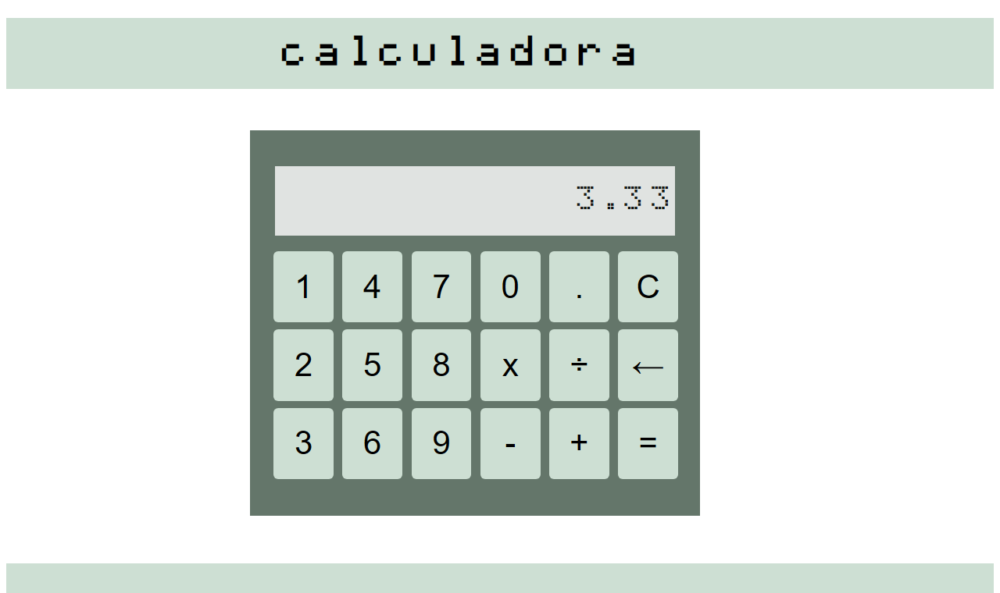
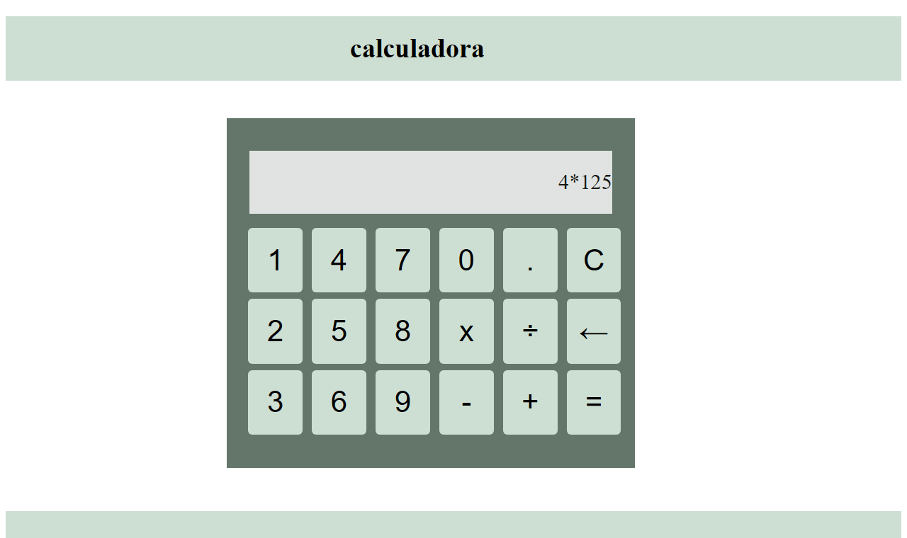

# Calculadora

[](LICENSE)

Calculadora web feita com HTML, CSS e JavaScript puro, com as quatro operações básicas, números decimais e botões para apagar o último dígito ou limpar o visor.

**Acesse o app:** https://plovatto.github.io/calculadora/

> **Projeto de estudo (2022):** um dos meus primeiros projetos em JavaScript, mantido aqui para mostrar o início da minha evolução como desenvolvedora.

<p align="center">
  
</p>

<p align="center"><em>Divisão com resultado decimal</em></p>

<table>
  <tr>
    <td width="50%"></td>
    <td width="50%"></td>
  </tr>
  <tr>
    <td align="center"><em>Expressão digitada</em></td>
    <td align="center"><em>Resultado com duas casas decimais</em></td>
  </tr>
</table>

## Funcionalidades

- Soma, subtração, multiplicação e divisão
- Números decimais
- Botão `←` para apagar o último dígito
- Botão `C` para limpar o visor
- Resultado exibido com duas casas decimais
- Mensagem de erro ao calcular com o visor vazio

## Tecnologias

- HTML5
- CSS3
- JavaScript (manipulação do DOM e eventos de clique)
- GitHub Pages - hospedagem

## Como Executar

O projeto não tem dependências nem etapa de build.

Clone o repositório:

```bash
git clone https://github.com/Plovatto/calculadora.git
```

Acesse a pasta do projeto e abra o arquivo `index.html` no navegador:

```bash
cd calculadora
```

## Deploy

O site é publicado no GitHub Pages diretamente a partir da branch `main`, sem etapa de build.

## Estrutura do Projeto

```text
├── css/
│   └── style.css     # Estilos da calculadora
├── js/
│   └── script.js     # Lógica dos botões e do cálculo
├── docs/             # Imagens usadas neste README
└── index.html
```

## Licença

Distribuído sob a [Licença MIT](LICENSE).
